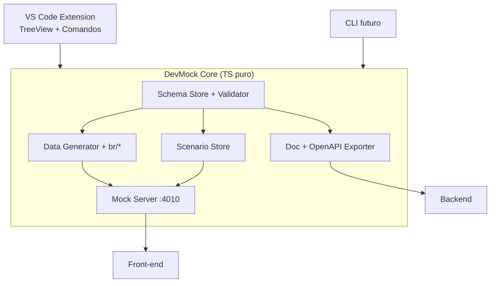

# Arquitetura — Visão

## 1. Visão
Duas camadas (§28 do original): **DevMock Core** (regra de negócio pura, sem dependência de editor) + **adaptadores finos** (VS Code Extension no MVP, CLI pós-MVP). O Schema é a fonte única da verdade; tudo deriva dele.

## 2. Decisões
| Decisão | Alternativas | Motivo |
|---------|--------------|--------|
| Core puro TS, zero dependência de `vscode` API | Lógica dentro da Extension | Reuso no CLI/CI futuro sem reescrever; testável com vitest puro |
| Extension como adaptador fino (TreeView + comandos → Core) | Extension gorda | Troca de UI não quebra regra de negócio |
| Mock Server embutido no Core (http nativo) | Depender de json-server externo | Zero instalação extra, porta configurável, cenários nativos |
| Arquivos JSON versionáveis como persistência | SQLite/embedded DB | Git-friendly, diff legível, sem migração |

## 3. Componentes
- Core (`@devmock/core` futuro package): `schemaStore, validator, dataGenerator (incl. br/*), mockServer, docExporter, scenarioStore`
- Extension (VS Code): TreeView, Webview de form, comandos, file watcher → chama Core
- Mock Server: http local, default `4010`, rotas geradas por Schema + cenários
- CLI (futuro, PRD-08): `init/start/generate/export/validate` sobre o mesmo Core

## 4. Modelo de Dados
Ver [[04-Data-Model-devmock]] — `.devmock/{config.json, schemas/, scenarios/, docs/, openapi/}`.

## 5. Diagrama (Mermaid)

## 6. Implicações
- Git-friendly: tudo é arquivo; Core nunca escreve fora de `.devmock/` sem ordem
- Performance: Core síncrono para geração; server com `delayMs` simulado via `setTimeout`
- Segurança: 100% local, sem telemetria no MVP

## 7. Links
- PRDs: [[PRD-01-Core-Schema-Data]], [[PRD-02-Mock-Server]], [[PRD-03-VSCode-Extension]]
- Detalhes: [[01-Core-Model]], [[02-Mock-Server-Design]], [[03-Extension-Design]], [[04-Data-Model-devmock]], [[05-Integracoes-OpenAPI-TS]]
- ADR futura: `06-Extras/06-ADRs/ADR-001-Core-vs-Extension`
