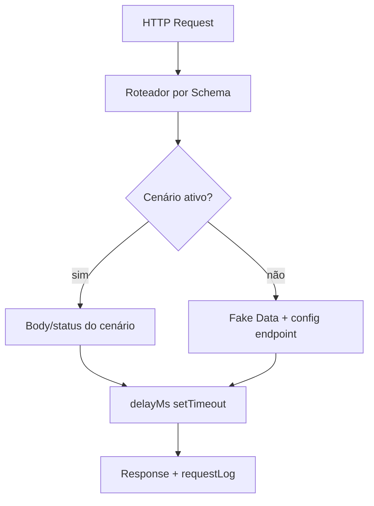

# Arquitetura — 02 Mock Server Design

## 1. Visão
Servidor http local embutido no Core (`start(port)`), rotas CRUD geradas por Schema, precedência `Cenário ativo > config do endpoint > defaults`. Estado em memória por sessão.

## 2. Decisões
| Decisão | Alternativas | Motivo |
|---------|--------------|--------|
| `node:http` nativo, sem framework | Express/Fastify embarcado | Zero dependência, boot <1s, controle fino de delay |
| Registro de rotas a partir do Schema (`/users`, `/users/:id`) | Config manual de rotas | Convenção REST reduz config (PRD-02 RF-01) |
| Store em memória (seed inicial + mutações da sessão) | Persistir POSTs em disco | Simplicidade MVP; restart volta ao seed (reprodutível) |

## 3. Componentes
- `routeTable.build(schemas)`: `GET /<plural>, GET /<plural>/:id, POST, PUT, PATCH, DELETE`
- `requestHandler`: resolve cenário ativo → aplica `delayMs` → serializa envelope
- `pagination`: `?page&limit` → `{data, total, page, limit}`; defaults `records:20, delayMs:300`
- `requestLog[]`: `{method, route, status, ms, scenario}` — Extension consome para o painel §14
- Erros padrão: `404 {error:"NOT_FOUND", message}` | cenários `401/500 {error, message}`

## 4. Modelo de Dados
```json
{
  "endpoint": "GET /users",
  "status": 200, "delayMs": 300, "records": 20,
  "pagination": { "enabled": true, "page": 1, "limit": 20 },
  "scenario": "Default"
}
```

## 5. Diagrama (Mermaid)


## 6. Implicações
- Performance: p95 <50ms + delay configurado; um server por workspace
- Porta ocupada: erro acionável (PID + como trocar em `config.json`)
- Segurança: bind só em `localhost`, nunca `0.0.0.0` no MVP

## 7. Links
- PRDs: [[PRD-02-Mock-Server]], [[PRD-04-Scenarios]]
- Processo: `BPM-04` (Fase 2)
