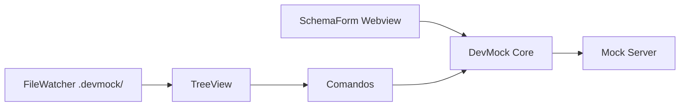

# Arquitetura — 03 Extension Design

## 1. Visão
Adaptador fino: TreeView + comandos + Webview de form, toda regra delegada ao Core. File watcher com debounce sincroniza edição manual ↔ Tree.

## 2. Decisões
| Decisão | Alternativas | Motivo |
|---------|--------------|--------|
| `TreeDataProvider` nativo (sem webview para a árvore) | Webview custom total | Performance e acessibilidade nativa do VS Code |
| Form de Schema em Webview só para criação/edição | Só JSON manual | Nível Simples exige UI guiada (PRD-03) |
| `FileSystemWatcher` em `.devmock/` com debounce 200ms | Polling | Refresh <200ms sem travar a UI |

## 3. Componentes
- `DevMockProvider (Tree)`: nós `Project > Schemas, Endpoints, Scenarios, Documentation, Settings` + nó `Mock Server 🟢/🔴`
- Comandos: `devmock.init|start|stop|generate|switchScenario|exportContract`
- `SchemaForm (Webview)`: tipos + dropdown de geradores `br.*`
- `Config`: lê `config.json` (porta, seedDefault, localeDefault)
- Estados: sem `.devmock/` → só CTA Init habilitado

## 4. Modelo de Dados
```json
{ "command": "devmock.start", "args": { "port": 4010 } }
```

## 5. Diagrama (Mermaid)


## 6. Implicações
- Textos PT-BR; termos técnicos em inglês
- Multi-root: um Core instance por pasta com `.devmock/`
- Erros do Core viram `showErrorMessage` com arquivo + campo

## 7. Links
- PRD: [[PRD-03-VSCode-Extension]]
- Processo: `BPM-01` (Fase 2)
- UX: `06-Extras/04-UX-UI-Extension` (Fase 5)
