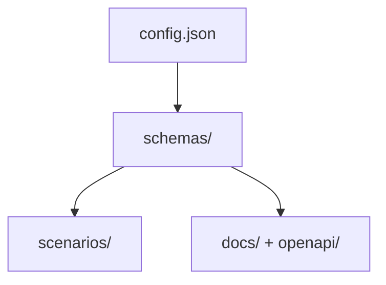

# Arquitetura — 04 Data Model `.devmock/`

## 1. Visão
Layout versionável (§24): tudo em arquivos pequenos e legíveis. `config.json` na raiz + 4 pastas.

## 2. Decisões
| Decisão | Alternativas | Motivo |
|---------|--------------|--------|
| Um JSON por Schema (`schemas/<model>.json`) | Arquivo único `schemas.json` | Conflitos de merge mínimos em time |
| Um JSON por cenário (`scenarios/<model>-<cenario>.json`) | Cenários inline no Schema | Cenário evolui sem tocar o contrato |
| `docs/` + `openapi/` como saída gerada (não fonte) | Versionar só fonte | Time pode revisar docs no PR; regeneração idempotente |

## 3. Componentes
```text
.devmock/
├── config.json            # port, seedDefault, localeDefault
├── schemas/
│   ├── user.json
│   ├── product.json
│   └── order.json
├── scenarios/
│   ├── user-empty.json
│   └── user-unauthorized.json
├── docs/
│   └── user.md
└── openapi/
    └── generated.yaml
```

## 4. Modelo de Dados
```json
{
  "port": 4010,
  "seedDefault": 12345,
  "localeDefault": "pt-BR",
  "activeScenarios": { "GET /users": "Default" }
}
```

## 5. Diagrama (Mermaid)


## 6. Implicações
- Keys ordenadas na escrita (diff estável); arquivos <50KB no MVP
- `.devmock/` inteiro commitado no repo do usuário (contrato compartilhado Front ↔ Back)

## 7. Links
- PRDs: [[PRD-01-Core-Schema-Data]], [[PRD-04-Scenarios]], [[PRD-05-Docs-Export]]
