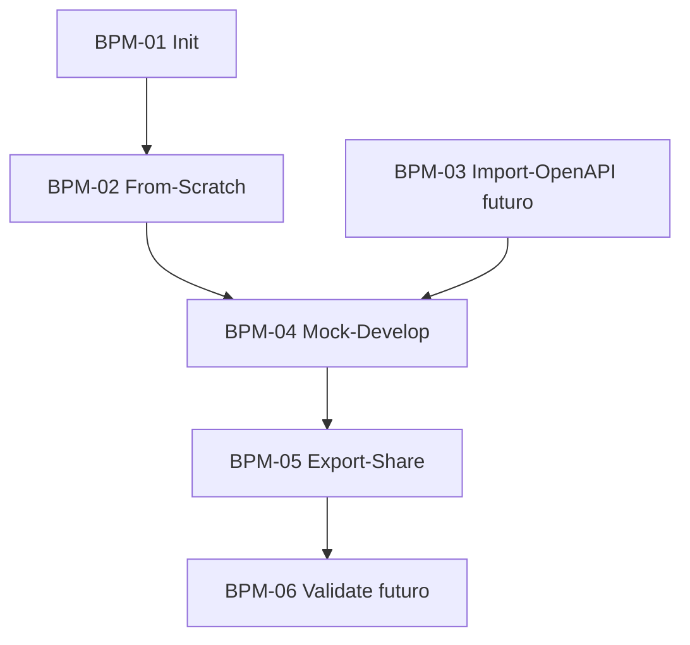

# Índice — Mapa de Processos

Fluxo completo §25: Instalar → Init → Criar/Importar → Schema → Fake Data → Mock → Cenários → Start → Desenvolver → Docs → Export → Backend → (futuro) Validar.



```dataview
TABLE status AS Status
FROM "03-Processos"
SORT file.name ASC
```

| BPM | Nome | Fase | Status |
|-----|------|------|--------|
| BPM-01 | Init Project | MVP | [[BPM-01-Init-Project]] |
| BPM-02 | Create From Scratch | MVP | [[BPM-02-Create-From-Scratch]] |
| BPM-03 | Import OpenAPI | v1.3.0 | [[BPM-03-Import-OpenAPI]] |
| BPM-04 | Generate Mock + Develop | MVP | [[BPM-04-Generate-Mock-Develop]] |
| BPM-05 | Export + Share Backend | MVP | [[BPM-05-Export-Share-Backend]] |
| BPM-06 | Validate Real API | futuro | stub |
