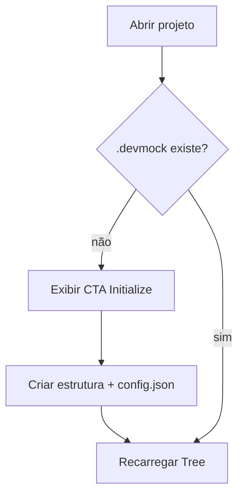

# Processo — BPM-01 Init Project

## 1. Objetivo
Criar a estrutura `.devmock/` versionável em projeto sem configuração (§5.2).

## 2. Atores
- Primário: dev Front-end
- Secundário: Extension (executor)

## 3. Pré-condições
- [ ] Pasta aberta no VS Code com `.devmock/` ausente

## 4. Passo a passo
1. Dev abre projeto → Extension detecta ausência e exibe CTA `[ Initialize Project ]`
2. Dev clica → Extension cria `.devmock/{config.json, schemas/, scenarios/, docs/, openapi/}` com `port: 4010, seedDefault, localeDefault: pt-BR`
3. Tree `DEV MOCK` recarrega exibindo as 5 seções vazias
4. Dev commita `.devmock/` no Git do projeto

## 5. Fluxo (Mermaid)

## 6. Pós-condições
- `.devmock/` existe e é idempotente (re-init não apaga Schemas)

## 7. Exceções
| Exceção | Tratamento |
|---------|------------|
| Sem permissão de escrita | `showErrorMessage` com path + causa |
| `config.json` corrompido | Oferece recriar com backup `.bak` |

## 8. Links
- PRD: [[PRD-03-VSCode-Extension]]
- Arquitetura: [[04-Data-Model-devmock]]
