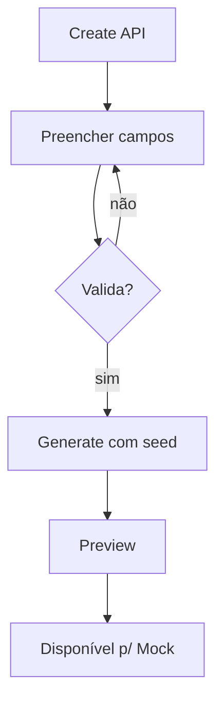

# Processo — BPM-02 Create From Scratch

## 1. Objetivo
Criar Schema + Fake Data determinística do zero (§7.1, §9).

## 2. Atores
- Primário: dev Front-end

## 3. Pré-condições
- [ ] BPM-01 concluído

## 4. Passo a passo
1. `Create API → From scratch` → informa nome do model (ex: `User`)
2. Preenche campos no form (tipo, required, generator `br.*`, enum) → salva `schemas/user.json`
3. Core valida; erro aponta campo + motivo
4. `Generate Fake Data`: informa `records: 20, seed` → preview JSON
5. Confirma → dados disponíveis para o Mock (BPM-04)

## 5. Fluxo (Mermaid)

## 6. Pós-condições
- `schemas/<model>.json` válido + preview reproduzível com o seed

## 7. Exceções
| Exceção | Tratamento |
|---------|------------|
| Enum vazio | Bloqueia save, pede ao menos 1 valor |
| `ref` inexistente | Erro com lista de Schemas disponíveis |

## 8. Links
- PRD: [[PRD-01-Core-Schema-Data]]
- Arquitetura: [[01-Core-Model]]
