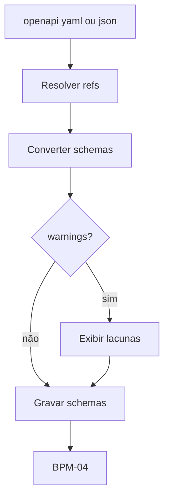

# Processo — BPM-03 Import OpenAPI

## 1. Objetivo
Gerar Schemas a partir do `openapi.yaml/json` do backend (§§18–19) e cair no fluxo normal (BPM-04).

## 2. Atores
- Primário: dev Front-end (importa)
- Secundário: dev Backend (fornece a spec)

## 3. Pré-condições
- [ ] BPM-01 concluído; arquivo OpenAPI 3.x acessível

## 4. Passo a passo
1. `DevMock: Import OpenAPI…` (ou `devmock import <arquivo>`) → seleciona a spec
2. Core resolve `$refs`, converte `components.schemas` → `schemas/*.json`
3. `warnings[]` exibidos (ex: `oneOf` ignorado, `$ref` remoto) — nada é inventado
4. Sem `--force` (CLI) ou com confirmação (Extension), arquivos existentes não são sobrescritos
5. Dev revisa o diff e segue para BPM-04 (mock imediato, cenários Default embutidos)

## 5. Fluxo (Mermaid)

## 6. Pós-condições
- `schemas/*.json` válidos (passam no validator); mock gerável

## 7. Exceções
| Exceção | Tratamento |
|---------|------------|
| Arquivo ilegível/não-OpenAPI | Erro acionável, nada é gravado |
| `$ref` remoto | Warning + campo `string` (segue importando o resto) |

## 8. Links
- PRD: [[PRD-06-Import-OpenAPI]] | SPEC: [[SPEC-Prompt-OpenAPI-Importer]]
