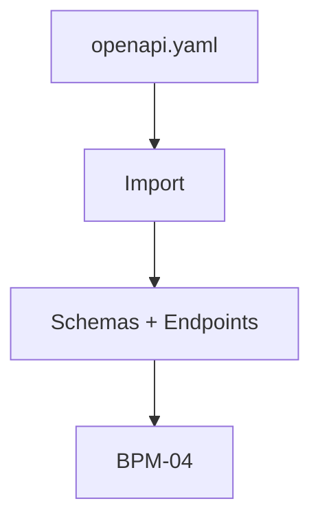

# Processo — BPM-03 Import OpenAPI (futuro, pós-MVP)

## 1. Objetivo
Gerar Schemas + endpoints + cenários a partir de `openapi.yaml` do backend (§18-19). Stub — detalhar na Fase de PRD-06.

## 2. Passo a passo (resumo)
1. `Import API` → seleciona `openapi.yaml`
2. Core converte paths/components → `schemas/` + endpoints + cenários Default
3. Dev revisa e segue para BPM-04

## 3. Fluxo (Mermaid)

## 8. Links
- PRD futuro: PRD-06
