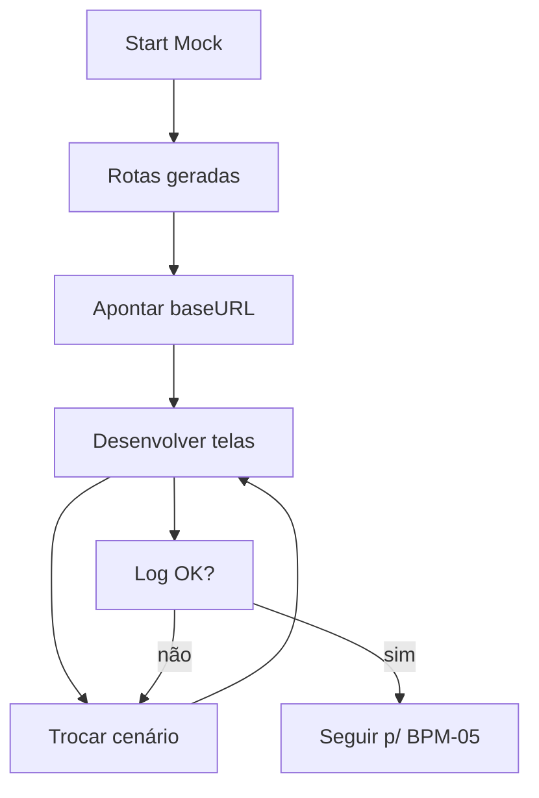

# Processo — BPM-04 Generate Mock + Develop

## 1. Objetivo
Subir o Mock (`:4010`), desenvolver o front contra ele e depurar via request log (§§10-14).

## 2. Atores
- Primário: dev Front-end
- Secundário: Mock Server

## 3. Pré-condições
- [ ] Ao menos 1 Schema válido (BPM-02)

## 4. Passo a passo
1. `Start Mock` → rotas CRUD geradas → `🟢 localhost:4010`
2. Aponta `baseURL` do front para `localhost:4010`
3. Configura endpoint se preciso (`delayMs`, `records`, paginação)
4. Alterna cenários (Default/Empty/401/500/Slow) e testa loading/empty/error/retry
5. Acompanha `REQUEST LOG` (método, rota, status, ms)

## 5. Fluxo (Mermaid)

## 6. Pós-condições
- Front funcional sem backend; cenários principais exercitados

## 7. Exceções
| Exceção | Tratamento |
|---------|------------|
| Porta ocupada | Mensagem com PID + troca em `config.json` |
| Schema inválido no start | Rota não registrada + erro por campo |

## 8. Links
- PRDs: [[PRD-02-Mock-Server]], [[PRD-04-Scenarios]]
- Arquitetura: [[02-Mock-Server-Design]]
