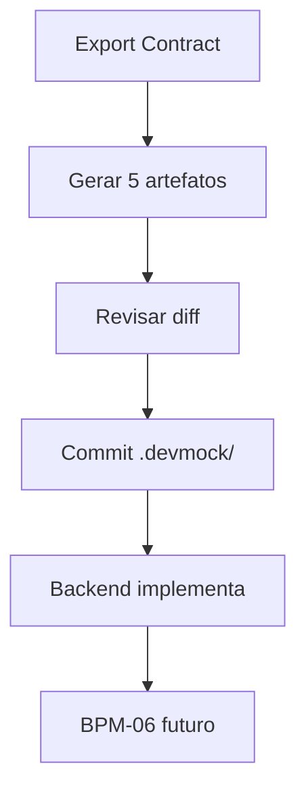

# Processo — BPM-05 Export + Share Backend

## 1. Objetivo
Transformar o Schema em contrato compartilhável: docs + OpenAPI + tipos (§§15-17).

## 2. Atores
- Primário: dev Front-end (exporta)
- Secundário: dev Backend (implementa a partir do contrato)

## 3. Pré-condições
- [ ] Schemas validados + mock funcionando (BPM-04)

## 4. Passo a passo
1. `Export Contract` → marca artefatos (OpenAPI JSON/YAML, JSON Schema, types, Markdown)
2. Core gera em `.devmock/openapi/` + `.devmock/docs/`
3. Dev revisa diff e commita `.devmock/` no Git
4. Backend implementa a API seguindo o contrato
5. (Futuro) BPM-06 valida a API real contra o contrato

## 5. Fluxo (Mermaid)

## 6. Pós-condições
- Contrato versionado; backend sabe exatamente a estrutura esperada

## 7. Exceções
| Exceção | Tratamento |
|---------|------------|
| OpenAPI inválido no parser | Bloqueia export, aponta campo causador |
| Re-export com diff inesperado | Mostra diff antes de sobrescrever |

## 8. Links
- PRD: [[PRD-05-Docs-Export]]
- Arquitetura: [[05-Integracoes-OpenAPI-TS]]
