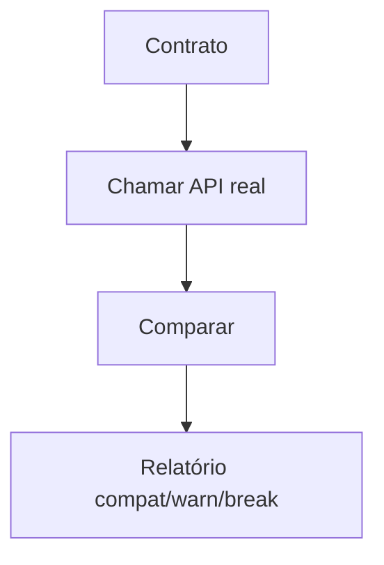

# Processo — BPM-06 Validate Real API (futuro, pós-MVP)

## 1. Objetivo
Comparar respostas da API real contra o contrato: `✓ Compatible / ⚠ Warning / ✕ Breaking Change` (§§22-23). Stub — detalhar na Fase de PRD-07.

## 2. Passo a passo (resumo)
1. Aponta `baseURL` real + seleciona endpoints
2. DevMock executa checks (tipos, enums, obrigatórios)
3. Relatório: `29 compatible, 2 warnings, 1 breaking change` (exemplo §23)

## 3. Fluxo (Mermaid)

## 8. Links
- PRD futuro: PRD-07
