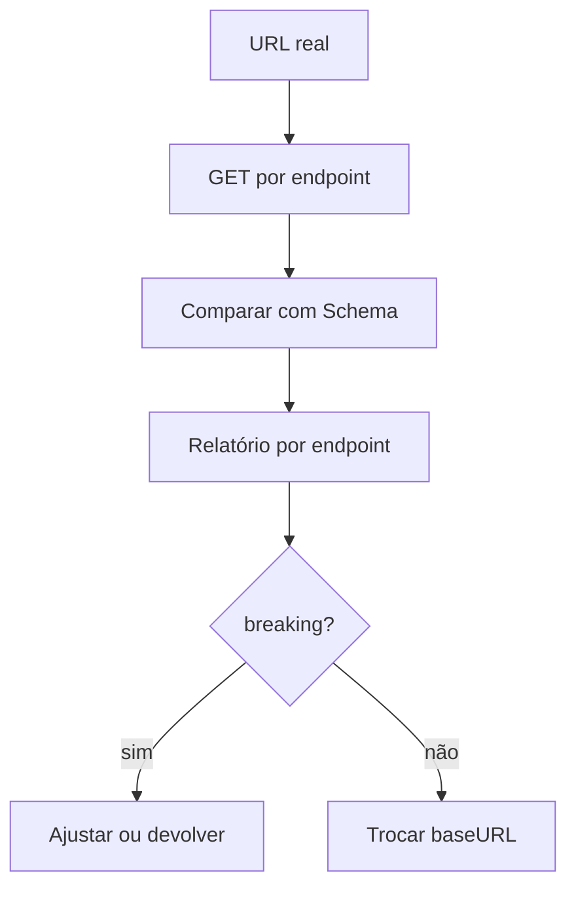

# Processo — BPM-06 Validate Real API

## 1. Objetivo
Comparar respostas da API real contra o contrato: `✓ Compatible / ⚠ Warning / ✕ Breaking Change` (§§22–23).

## 2. Atores
- Primário: dev Front-end (valida antes de trocar a `baseURL`)
- Secundário: dev Backend (recebe as divergências)

## 3. Pré-condições
- [ ] Backend no ar; Schemas válidos em `schemas/`

## 4. Passo a passo
1. `DevMock: Validate Real API…` (ou `devmock validate <baseUrl>`) → informa a URL real
2. DevMock faz `GET` em cada base path e valida até 5 itens por endpoint (só leitura, timeout 10s)
3. Relatório por endpoint: `X compatible, Y warnings, Z breaking` (exemplo §23)
4. Com Breaking: ajusta front ou devolve a lista ao backend; sem Breaking: troca a `baseURL` com confiança

## 5. Fluxo (Mermaid)

## 6. Pós-condições
- Relatório registrado; decisão de troca tomada com evidência

## 7. Exceções
| Exceção | Tratamento |
|---------|------------|
| Rede/timeout | Finding de erro por endpoint, não crash; CLI exit 1 |
| Resposta não-JSON | Finding de erro com status |

## 8. Links
- PRD: [[PRD-07-Contract-Validation]] | SPEC: [[SPEC-Prompt-Validator]]
