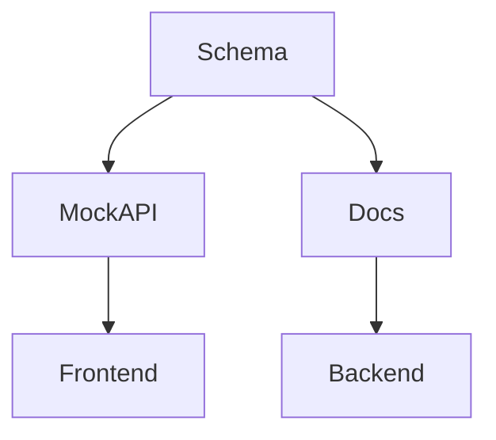

# Arquitetura — <% tp.file.title %>

## 1. Visão
<!-- Resumo em 3-5 linhas. Fonte única da verdade: Schema -->

## 2. Decisões
| Decisão | Alternativas | Motivo |
|---------|--------------|--------|
| | | |

## 3. Componentes
- Core:
- Extension (VS Code):
- Mock Server:
- CLI (futuro):

## 4. Modelo de Dados
```json
{
  "exemplo": "config.json / schema / scenario"
}
```

## 5. Diagrama (Mermaid)


## 6. Implicações
- Git-friendly:
- Performance:
- Segurança:

## 7. Links
- PRD:
- Processo:
- ADR:
