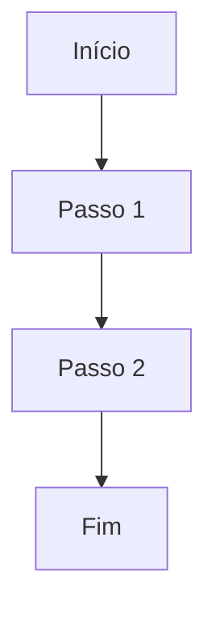

# Processo — <% tp.file.title %>

## 1. Objetivo
<!-- O que este processo entrega? Ex: Inicializar projeto .devmock/ -->

## 2. Atores
- Primário:
- Secundário:

## 3. Pré-condições
- [ ] Condição 1

## 4. Passo a passo
1. Passo 1
2. Passo 2
3. Passo 3

## 5. Fluxo (Mermaid)

## 6. Pós-condições
-

## 7. Exceções
| Exceção | Tratamento |
|---------|------------|
| | |

## 8. Links
- PRD:
- Arquitetura:
